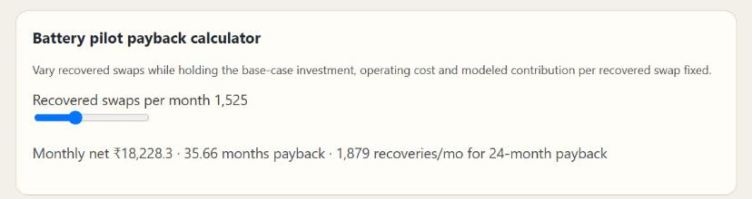
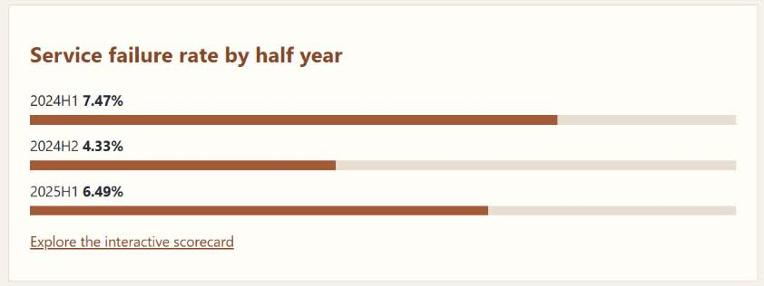

# Ampere Leak

**Where should a growing battery-swapping network invest when service reliability slips?**

Ampere Leak analyzes 18 months of simulated VoltRelay Energy operations across six Indian cities. It connects station failures, battery availability, rider retention, and unit economics to a recommendation leadership can test.

[**Open the live scorecard**](https://ampere-leak-web.vercel.app/) · [**Read the executive report**](https://ampere-leak-web.vercel.app/analysis_report.html) · [**Open the analysis notebook**](ampere_leak_colab.ipynb)

## The findings

| Evidence | What it means |
| --- | --- |
| **3.81 million eligible attempts** | The analysis reconciles eight source tables and uses eligible attempts as the denominator for service metrics. |
| **4.33% → 6.49% failure rate** | Reliability worsened from 2024 H2 to 2025 H1. Unavailable charged packs were the largest recorded reason for failure. |
| **₹13.59 modeled contribution per completed swap** | Unit economics improved year over year even as reliability declined versus the preceding half. |

**Recommendation.** Test additional charged-pack inventory at comparable stations before expanding. Decide whether to scale based on recovered swaps, incremental contribution, and 30-day rider return.

## Explore the live demo

### Battery pilot payback calculator

Change the number of recovered swaps per month to see how the modeled payback changes. Use the calculator to identify the recovery threshold the pilot would need to validate.

[](https://ampere-leak-web.vercel.app/)

### Executive analysis report

Compare the three half-year baselines before tracing the operational and financial drivers. The report addresses all six core questions and documents the assumptions behind its recommendations.

[](https://ampere-leak-web.vercel.app/analysis_report.html)

## Reproduce the analysis

Use Python 3.11 or 3.12. Put the eight source files in dataset/ or pass the original ZIP to -Dataset. The runner creates a fresh directory for the evidence, report, and scorecard, then verifies the aggregate results.

```powershell
python -m venv .venv
.\.venv\Scripts\python.exe -m pip install -r requirements.txt
powershell -NoProfile -ExecutionPolicy Bypass -File .\run.ps1 -Dataset .\dataset
```

For Colab, open the [notebook](ampere_leak_colab.ipynb), set your Drive paths, and run all cells. The [methods guide](METHODS.md) documents joins, denominators, and release checks.

## Data and deployment

The source is the synthetic dataset provided by Gradient Learnings for the Data Analytics Hackathon. The contribution calculation includes modeled battery wear, and the payback scenarios depend on stated assumptions. Findings about pricing, equipment, and retention describe observational relationships.

The static site lives in web/ and is deployed on Vercel. For another deployment, select web as the root directory and use the Other framework preset with an empty build command.
